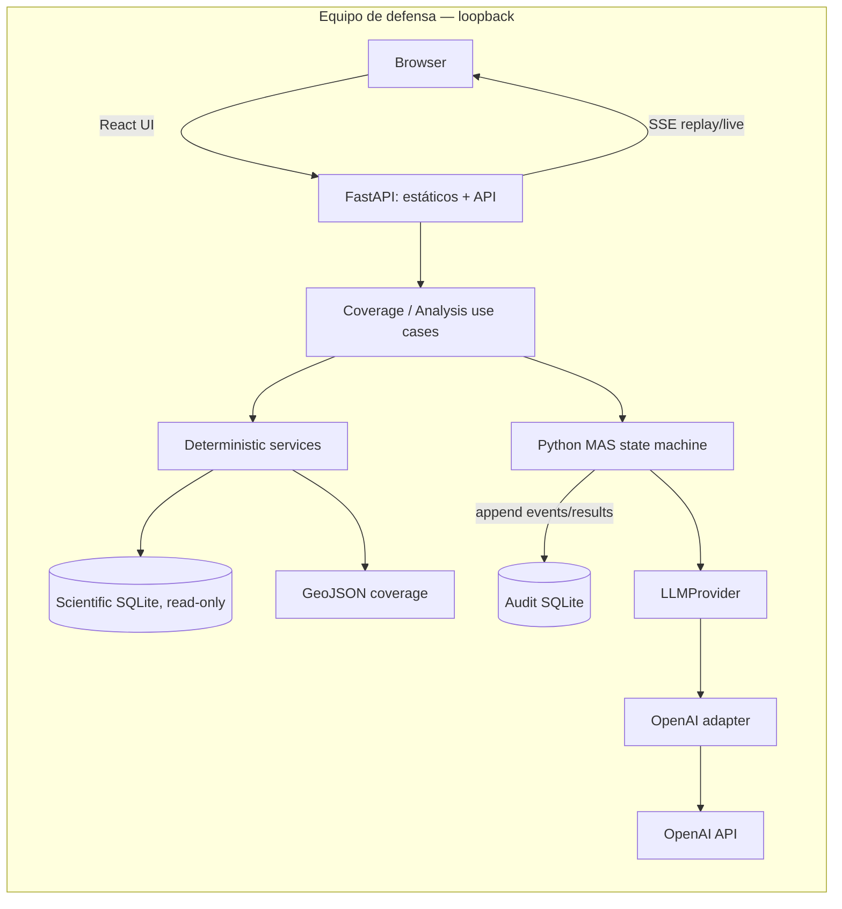

# FireWatch — Propuesta de arquitectura técnica para discusión

**Estado:** decisiones ratificadas como baseline de Architecture; no autoriza iniciar implementación.  
**Fuente de verdad de decisiones:** [Architecture Spine](./ARCHITECTURE-SPINE.md) y [memlog](./.memlog.md).  
**Base de producto:** [PRD](../prds/prd-sistema-incendios-forestales-2026-10-07/prd.md), [Experience UJ-1](../ux-designs/ux-sistema-incendios-forestales-2026-10-07/EXPERIENCE.md) y [Design](../ux-designs/ux-sistema-incendios-forestales-2026-10-07/DESIGN.md).

## 1. Resumen de la propuesta

FireWatch se implementa como un **monolito modular local**: una aplicación React/TypeScript atendida por FastAPI, con orquestación determinística en Python. El proceso sirve al frontend, consulta un snapshot científico local de solo lectura, persiste cada run/traza/evidencia en un SQLite de auditoría separado y, únicamente para contextualización, validación y explicación, llama a OpenAI mediante un puerto `LLMProvider`.

La ejecución queda delimitada por `weather_id + fecha local`. El rango temporal de la interfaz solo permite navegar fechas: cada fecha ejecutada origina su propio `analysis_id`, FWI, referencia histórica, explicación, evidencia y secuencia MAS. El FWI y demás resultados científicos provienen de datos y servicios determinísticos; no son calculados ni modificados por el LLM.

La selección visual concreta del contexto queda abierta a UX. La API no acepta coordenadas libres, no interpola y no reemplaza una selección inválida por otra ubicación.

El contrato mínimo de selección es frontend → feature GeoJSON de cobertura → `properties.weather_id` canónico → request diario `{weather_id, date}`. El backend valida que el ID pertenece a la cobertura de 169 elementos y que la fecha está disponible; el control visual y la política sobre centros/celdas quedan en UX.

## 2. Decisiones adoptadas y alternativas consideradas

| Área | Alternativas razonables | Propuesta y motivo para FireWatch |
| --- | --- | --- |
| Forma del sistema | Microservicios; monolito por capas; monolito modular con puertos/adaptadores | **Monolito modular.** Mantiene límites comprobables sin desplegar servicios/colas independientes. Es más fácil de ejecutar, probar y explicar en una defensa académica. Los puertos aíslan almacenamiento, proveedor LLM y API, permitiendo sustituirlos sin mover reglas científicas. |
| Orquestación MAS | Framework de agentes; grafo de workflow; máquina de estados Python propia | **Máquina de estados Python propia.** El flujo tiene tres roles, una única revisión máxima y contratos limitados; la lógica explícita reduce abstracción, facilita reproducibilidad de transiciones y permite que cada evento real se persista antes de mostrarse. No se elige CrewAI/LangGraph porque no se necesita su superficie adicional para este flujo cerrado. |
| Roles MAS | Un agente general; muchos agentes especializados; tres agentes acotados | **Tres roles LLM:** contextualizador, validador y explicador. La recuperación, los cálculos y los checks de integridad siguen siendo determinísticos y no son agentes. La separación ayuda a explicar qué es evidencia, revisión y narrativa sin multiplicar actores. |
| Modelo/proveedor | Modelo local; proveedor API único; varios modelos/proveedores | **OpenAI API, un modelo compartido por los tres roles**, detrás de `LLMProvider`. Reduce riesgo de rendimiento y configuración de hardware antes de la defensa. El modelo concreto y parámetros se seleccionan con pruebas durante implementación. `MockLLM` se selecciona explícitamente en desarrollo y pruebas, nunca como fallback de producción. El adaptador real queda deshabilitado/fail-closed hasta tener modelo, timeout finito, retries acotados, techo de uso/costo por run y controles de datos de la cuenta verificados. |
| Herramientas de agentes | Acceso directo a APIs, SQL o filesystem; herramientas generales; evidencia inyectada | **Sin herramientas arbitrarias para agentes.** El orquestador recupera evidencia y construye un `EvidenceBundle` inmutable. Cada rol recibe solo los campos permitidos por su contrato. Esto elimina acceso del LLM a fuentes externas, secretos, archivos o escritura científica. |
| Backend | Flask; Django; FastAPI | **FastAPI.** Ya hay procesamiento Python y contratos de datos; FastAPI encaja con tipos/Pydantic, OpenAPI y SSE sin exigir una estructura de proyecto mayor. Flask requeriría más ensamblado manual para los contratos; Django incorporaría capacidades no requeridas como ORM/auth/admin. |
| Frontend | HTML servido por servidor; React/TypeScript; framework SSR completo | **React + TypeScript + Vite.** El recorrido tiene expansión progresiva, tablas, estados de ejecución y actualizaciones SSE; React cubre esa interacción. Vite produce recursos estáticos que FastAPI puede servir para mantener un solo origen y despliegue. Un framework SSR añadiría complejidad sin una necesidad de SEO o servidor frontend separado. |
| Datos científicos | Consultar APIs fuente en cada run; regenerar todo al iniciar; snapshot local versionado | **Snapshot local inmutable, preprocesado y verificado.** Evita dependencia de red/servicios externos para ERA5/FIRMS durante la demo y fija una referencia reproducible. Se retienen los generadores/validadores existentes y sus CSV gzip; un release builder separado valida y convierte esos outputs al SQLite + GeoJSON consumido por el runtime. No se reescriben transformaciones científicas para el MVP ni se ejecuta el pipeline por request. |
| Geoespacial | PostGIS; servicio GIS; GeoJSON + SQLite | **GeoJSON EPSG:4326 y `weather_id` canónico.** Son suficientes para las 169 ubicaciones/celdas existentes y evitan operar un servidor espacial. No se usa interpolación ni se toma una decisión visual sobre centros versus celdas que intersectan. |
| Persistencia | Sin persistencia; una base compartida para todo; DB científica de solo lectura y audit DB independiente | **Dos SQLite con responsabilidades distintas.** El snapshot científico se abre de solo lectura; otro SQLite local recibe runs, resultados, evidencia y eventos. Separarlos protege el dataset y permite una política de purga independiente. |
| Eventos en vivo | Polling; SSE; WebSocket | **SSE.** La comunicación es unidireccional (servidor → cliente) y cada mensaje procede del registro persistido; reconexión con `Last-Event-ID`. WebSocket sería bidireccional sin requisito que lo justifique. |
| Despliegue | Solo local; hosting público; ambos | **Local en el equipo de defensa.** Menor operación, sin nube ni autenticación de usuarios para el MVP. El dominio no depende del despliegue, pero una exposición remota requerirá controles de seguridad adicionales antes de migrar. |
| FWI en ejecución | Recalcular el FWI en cada request; cargar el resultado precomputado | **Cargar resultados diarios precomputados del snapshot.** El pipeline versionado conserva el procesamiento científico reproducible; la API no debe ejecutar de nuevo el pipeline entero ni atribuir sus cálculos a un agente. |
| Auditoría | Solo log de aplicación; estado final mutable; eventos append-only | **Eventos append-only en SQLite.** Permiten reconstruir el orden, mostrar solo trabajo registrado, diagnosticar parciales y reanudar SSE desde una secuencia conocida. El log es autoridad para estados; run row y resultado son proyecciones transaccionales. La retención borra el conjunto vencido; no reescribe eventos retenidos. |

## 3. Vista de extremo a extremo

### Secuencia de una ejecución diaria

1. El cliente obtiene cobertura y fechas disponibles con `GET /api/coverage`. La respuesta identifica las ubicaciones por `weather_id` y presenta las geometrías/metadatos necesarios; el control visual no está definido aquí.
2. El usuario elige `weather_id` y una fecha local disponible e inicia un análisis. `POST /api/analyses` recibe un solo día, valida contra cobertura y devuelve `202` con un `analysis_id` nuevo.
3. El servidor consulta, en modo de solo lectura, meteorología, componentes FWI, referencia histórica local-mensual, detecciones FIRMS pertinentes y procedencia/limitaciones desde la misma versión de snapshot.
4. Servicios determinísticos validan disponibilidad/unidades y calculan la diferencia FWI–referencia. Los valores ausentes permanecen nulos con motivo explícito. “Sin detecciones FIRMS” se informa como tal y no como ausencia de incendio.
5. El orquestador registra el run y crea un EvidenceBundle versionado. El contextualizador produce claims ligados a `evidence_refs`; el validador devuelve `approved` o `revision_requested` con hallazgos; se permite una sola revisión, como nueva intervención. El explicador recibe claims aprobados y evidencia autorizada y genera secciones estructuradas.
6. Cada evento se confirma en SQLite antes de publicarse por SSE. El servidor valida outputs y referencias, persiste la explicación/resultados y transiciona el run a `completed`, `partial` o `failed`.
7. La UI conserva la selección y consulta el resultado, las fuentes, las limitaciones, la evidencia y el detalle de traza desde la misma superficie.

## 4. Contratos HTTP y de eventos propuestos

| Operación | Contrato esencial |
| --- | --- |
| `GET /api/coverage` | GeoJSON con 169 features; cada `properties.weather_id` es el ID canónico que usará el POST, más geometría, centro, banderas `center_inside`/`intersects`, fechas disponibles y procedencia/unidades. Las banderas informan a UX pero no deciden qué features mostrar como seleccionables. |
| `POST /api/analyses` | Entrada `{weather_id, date}`; la fecha es local `YYYY-MM-DD`, no rango. Respuesta `202 {analysis_id, status: "queued"}`. Backend valida pertenencia del ID y disponibilidad de fecha; rechaza explícitamente el contexto inválido sin sustituir coordenada/fecha. |
| `GET /api/analyses/{id}` | Estado actual, resultado si existe, fuentes/limitaciones, release del snapshot, proveedor/modelo y versiones de prompt/schema. No da acceso a un historial global. |
| `GET /api/analyses/{id}/trace` | Proyección derivada de eventos: agente, tarea, estado, resultado/evidencia y secuencia general. Cada referencia resuelve evidencia persistida de ese run. Incluye disponibilidad/completitud explícita para distinguir sin eventos registrados todavía, traza disponible, traza incompleta (incluido run terminal sin eventos esperados) y traza no disponible/error; una lista vacía no demuestra que no participaran agentes. |
| `GET /api/analyses/{id}/evidence/{evidence_id}` | Valor o ausencia real, unidad si aplica, fecha/ubicación, fuente, release y clave de registro; no expone rutas arbitrarias del filesystem. |
| `GET /api/analyses/{id}/events` | SSE con `id=sequence`, replay exclusivo y ordenado tras `Last-Event-ID`. La consulta durable de SQLite manda; notificaciones solo despiertan una nueva lectura y un recheck periódico evita pérdida en el límite replay/live. Los clientes deduplican por `(analysis_id, sequence)`. Cursor futuro es error explícito, hueco es reset/incomplete explícito y run purgado/no encontrado devuelve error explícito; nunca continuar en silencio. Una reconexión de SSE o recarga de la vista solo puede continuar si el cliente conserva `analysis_id`; no existe listado/restauración de historial de usuario. El run backend continúa aunque se cierre el navegador. |
| `GET /api/health/ready` | Estado de configuración local y snapshot; errores de integridad impiden readiness. No garantiza que un proveedor externo esté disponible para una llamada futura. |

### Tipos y estados del MAS

- **Run:** `queued → running → completed | partial | failed`.
- **Intervención:** un `intervention_id` por llamada real; un evento start establece estado derivado `running`; terminal `completed` o `failed` cierra esa intervención.
- **Decisión del validador:** evento propio `approved` o `revision_requested`. No sustituye el estado de ejecución de la intervención.
- **Nueva revisión:** nuevo `intervention_id` y nuevos eventos; nunca se edita el intento anterior.
- Si el validador vuelve a solicitar revisión tras la única revisión permitida, se detiene la rama explicativa y el run termina `partial` conservando el resultado FWI determinístico y las referencias disponibles a los hallazgos; no se presenta una explicación no aprobada como aceptada.
- **Tipos mínimos de evento:** `run_queued`, `run_started`, `analysis_core_result_persisted`, `tool_failed`, `intervention_started`, `intervention_completed`, `intervention_failed`, `review_approved`, `review_revision_requested`, `run_interrupted`, `run_completed`, `run_partial`, `run_failed`, según el esquema común `trace-event.v1`. `run_interrupted` y `tool_failed` son eventos de sistema/herramienta, nunca intervenciones o agentes.
- **Campos comunes:** `schema_version`, `analysis_id`, `sequence` monotónica iniciada en 1, `event_type`, `occurred_at` UTC e `idempotency_key`. Intervenciones exigen `intervention_id` único por run, `agent_role`, `task` y refs de entrada; completadas exigen resumen/ref de salida y evidencia; fallidas, código de error/salidas afectadas; decisiones del validador, id de su intervención, decisión y refs de issue/claim; terminales de run, referencia de resultado/outputs afectados según corresponda. Las referencias de evidencia/resultados se resuelven solo dentro del análisis.
- `tool_failed` identifica el nombre/ID real de la herramienta, tarea, código de error y outputs afectados. Una herramienta determinística que falla genera este evento; la aplicación conserva los resultados no afectados y cierra `partial` si ya existe FWI central utilizable o `failed` si no. No muestra datos dependientes de una herramienta fallida como válidos.
- **Versionado/consistencia:** los schemas JSON versionados en `contracts/schemas/` son la fuente común para productor, SQLite, API/SSE y proyección. Los consumidores y productores validan contra ellos; extensión opcional requiere versión minor, cambio incompatible una versión major. Evento terminal del run y resultado/procedencia se persisten atómicamente con la proyección de estado; si falla la transacción no se muestra ni el terminal ni resultado. La secuencia de eventos append-only es autoridad y la fila de run es proyección. En el reinicio del backend, cada run retenido aún `queued`/`running` se cierra transaccionalmente con `run_interrupted` seguido por `run_partial` si su FWI determinístico utilizable ya estaba confirmado, de lo contrario `run_failed`; no se reanuda ni reintenta una llamada LLM automáticamente.
- El evento `analysis_core_result_persisted` confirma el FWI determinístico y su evidencia en SQLite antes de cualquier llamada LLM; la recuperación tras reinicio decide `partial`/`failed` a partir de ese commit, no de estado volátil.
- Los outputs estructurados pueden persistirse después de validarse. No se guardan prompts, razonamiento oculto ni fallbacks narrativos que aparenten éxito.
- La UI anuncia cambios significativos de traza a tecnologías de asistencia sin emitir una interrupción por cada evento; el patrón exacto respeta la semántica accesible de la UI aprobada.
- Eventos terminales de run e intervención y comienzos de run/intervención se anuncian de forma accesible; eventos repetitivos de bajo nivel pueden agruparse u omitirse de anuncios, pero siguen inspeccionables. Teclado/lector de pantalla debe poder identificar por texto si la traza no se ha registrado aún, está disponible, incompleta o no disponible.

## 5. Componentes y responsabilidades

| Componente | Responsabilidad | No debe hacer |
| --- | --- | --- |
| Superficie React | Contexto, inicio/consulta, síntesis y detalle progresivo; representar faltantes y errores accesiblemente; consumir SSE y replay. | Calcular FWI, inferir estados de agente o reemplazar resultados con cero. |
| API FastAPI | Validar requests, exponer contratos OpenAPI, controlar respuestas/errores, servir estáticos y SSE. | Contener reglas científicas o hablar directamente con una fuente externa no versionada. |
| Analysis application service | Validar `weather_id + date`, construir EvidenceBundle, dirigir uso de datos, orquestación, persistencia y resultado. | Delegar decisiones de estado al frontend o al texto LLM. |
| Snapshot adapter | Consultas parametrizadas y de solo lectura a datos científicos; procedencia, unidades, faltantes y cobertura. | Escribir/modificar el snapshot durante un análisis. |
| Deterministic services | Reglas de disponibilidad, comparación histórica, FWI integrity/source checks y validación de evidence refs. | Inferir resultados ausentes o tratarlos como cero. |
| MAS orchestrator | Ejecutar los tres roles en orden, registrar transiciones, limitar revisión y producir resultado parcial/error. | Exponer herramientas generales o permitir escritura del dataset a los agentes. |
| Contextualizador | Expresar claims contextuales usando evidencia y reglas suministradas; cada claim incluye evidencia. | Crear valores o inferir incendios/probabilidades. |
| Validador | Revisar soporte de claims, límites metodológicos, referencias y lenguaje permitido; aprobar o pedir revisión. | Recalcular FWI o editar eventos previos. |
| Explicador | Crear explicación legible separando observación, cálculo determinístico e interpretación a partir de claims/evidencia aprobados. | Sustituir cifras científicas o inventar referencias. |
| LLMProvider/OpenAI adapter | Convertir contrato neutral a llamada del proveedor, validar salida estructurada, reportar errores/cuotas/tiempo; impedir llamadas reales sin modelo/timeout/retry/techo de uso y controles de datos validados. | Filtrar detalles del SDK a la máquina de estados o persistir secreto/razonamiento. |
| MockLLM | Respuestas determinísticas de prueba para transiciones, revisión, traza, SSE y UI. | Activarse automáticamente cuando falla OpenAI en un run real. |
| Audit repository | Transacciones locales, estado actual, evidencia y eventos inmutables; purga configurable. | Guardar historial indefinido, prompts o información no necesaria. |

## 6. Datos, procesamiento y restricciones de selección

### Snapshot y fuentes

- Fuentes ya incorporadas: IGN para geometría, ERA5 vía Open-Meteo para meteorología, NASA FIRMS VIIRS S-NPP para detecciones, y FWI clásico.
- Las fuentes se integran offline a un snapshot versionado; no se hacen llamadas de datos meteorológicos/FIRMS al ejecutar un análisis.
- Se preservan los generadores existentes de `src/data` (cuadrícula, FWI provincial, integración FIRMS–FWI y dataset analítico) y sus salidas CSV gzip. Un release builder nuevo valida y convierte las salidas publicadas al bundle SQLite + GeoJSON; es el único seam entre pipeline offline y runtime.
- Bundle mínimo: `manifest.json`, SQLite científico leído en modo `ro`, `coverage/province.geojson` (límite IGN) y `coverage/weather-grid.geojson` (cobertura con 169 `weather_id`s).
- El manifiesto incluye `bundle_version`, `schema_version`, `release_id`, referencia de procedencia/fuentes, fechas/cobertura y para cada archivo su ruta relativa, media type, tamaño en bytes y SHA-256. La configuración local fija `FIREWATCH_SNAPSHOT_VERSION` y `FIREWATCH_SNAPSHOT_MANIFEST_SHA256`; los hashes de payload se comparan con los valores incluidos en el manifiesto validado.
- Al iniciar, validar manifiesto y versiones compatibles, digest esperado del manifiesto, presencia/tamaño/checksum de todo payload, integridad/esquema SQLite, cobertura provincial/geometrías y correspondencia de los 169 IDs entre DB y GeoJSON. Cualquier falta, versión incompatible o mismatch impide readiness: fail-closed, sin modo writable, bundle alternativo ni descarga en runtime.
- El snapshot es local e inmutable, provisionado para la demostración fuera de Git; no se diseña infraestructura remota de distribución ni reemplazo automático.
- Datos disponibles para disclosure/procedencia del estudio: FWI 2020–2025, 169 ubicaciones y 370.448 registros diarios; checks reportados sin faltantes, duplicados, infinitos ni índices FWI negativos. El dataset analítico 2021–2025 tiene 308.594 celdas-día; 2.286 con detección asociada, 306.308 sin ella y 10.956 detecciones preservadas en `firms_count`.
- En 169 ubicaciones del grid de 0,25° EPSG:4326, 139 centros están dentro del límite provincial y 30 celdas intersectan la provincia aunque el centro quede fuera. Architecture expone esta diferencia; UX define si esos casos forman parte de la selección.
- Fechas del análisis principal: 2021–2025; 2020 solo spin-up. Cada run es diario y no agrega FWI entre días.

### Cálculos y significado

- El runtime lee FWI diario y variables meteorológicas procesadas del snapshot; el pipeline Python sigue siendo la fuente de generación offline.
- El FWI usa datos a las 12:00 hora local de La Rioja, con precipitación acumulada en las 24 horas previas.
- La mediana histórica por `weather_id + mes` y la diferencia se calculan determinísticamente a partir de los datos disponibles.
- Los resultados descriptivos globales de PRD FR-8 pertenecen a un artefacto/paquete de estadísticas offline versionado, no a una inferencia LLM ni a un cálculo predictivo por cada run. La API/proyección de procedencia expone población y denominador: medianas globales FWI 19,071 (sin detección asociada) y 22,172 (con detección asociada), distinguiéndolas de la comparación ajustada local-mensual; de las 2.286 celdas-día con detección, 64,04% excedieron su referencia local-mensual y la anomalía mediana fue +3,183 puntos FWI. Las medianas de anomalía fueron positivas en los 12 meses y cinco años estudiados, con intensidad distinta. La interpretación se limita a asociación descriptiva y no a precisión/sensibilidad o incendios predichos.
- Python FWI fue contrastado con R `cffdrs` durante **31 días de enero de 2023**, con diferencia máxima observada 0 para FFMC, DMC, DC, ISI, BUI y FWI en ese período comprobado. Esto no se generaliza a otras fechas/datasets.
- Se usan estados iniciales FFMC=85, DMC=6, DC=15 y continuidad durante 2020 como spin-up; no es calibración ecológica específica validada para La Rioja. El pipeline incluye la corrección local para `drought_code` cuando precipitación ≤2,8 mm; el release builder debe preservar resultados de esa ruta.
- Unidades meteorológicas: temperatura °C; humedad relativa %; viento km/h; precipitación mm. Los seis componentes FWI son índices sin unidad física.
- FIRMS `type=0` es *presumed vegetation fire*. El pipeline asigna cada detección a la ubicación ERA5 más cercana mediante distancia Haversine y conserva la distancia; la asociación existente no aplica un cutoff máximo. La evidencia individual consultable debe conservar la distancia pertinente, no solo el conteo agregado.
- Las distancias de asociación observadas son media 10,234 km y máxima 20,944 km. Una detección no confirma por sí sola un incendio individual. La asociación temporal al FWI de las 12:00 del mismo día es histórica/descriptiva, no causal ni predictiva; una detección anterior al mediodía puede quedar emparejada con un FWI calculado usando condiciones meteorológicas posteriores de ese mismo día.
- La API debe permitir consultar desde el resultado esos conteos y checks de calidad del conjunto (por ejemplo, como metadatos/procedencia recuperables), diferenciándolos de la integridad de archivos verificada al arrancar. No convertirlos en nuevos indicadores predictivos.

### Selección pendiente para UX

La API restringe el contexto a un `weather_id` conocido y una fecha disponible. Devuelve geometría/fuentes/banderas para que UX pueda cerrar el patrón de selección. No resuelve si la interacción parte de un punto, una celda o una zona, ni cómo presentar las 30 celdas intersectantes con centro externo. Un contexto inválido se explica, no se corrige silenciosamente.

## 7. Persistencia, errores y observabilidad

### Stores

1. **Scientific store:** snapshot SQLite abierto como solo lectura; solo el release validado.
2. **Audit store:** SQLite local con tablas lógicas `analysis_runs`, `trace_events` y `evidence_items`. `trace_events` mantiene secuencia estable por run; `evidence_items` se resuelven por IDs internos y conservan procedencia/valores/unidades/faltantes. Los eventos no se actualizan; su purga ocurre junto con run/evidencia/resultados al cumplir retención.
3. **Retención:** 30 días desde la creación, valor por defecto configurable (`FIREWATCH_RUN_RETENTION_DAYS=30`). La purga local no habilita UI de historial. Un período mayor o menor no se incorpora sin cambiar configuración.

### Errores y recuperación

- Request espacial/temporal inválido: rechazo explícito sin crear un análisis falso ni sustituir coordenada/fecha.
- Dataset ausente/corrupto/checksum incorrecto: la app no queda ready; no usa silenciosamente otro release.
- FWI central no disponible: run `failed`; la interfaz informa la parte no disponible.
- FWI central disponible pero referencia, FIRMS o explicación no disponible: conservar las partes válidas y marcar `partial` cuando un requisito del análisis quede afectado. FIRMS sin detecciones es un resultado descriptivo válido, no fallo.
- Error del proveedor, timeout, cuota, rechazo o JSON/schema inválido: evento de error de intervención y run `partial` si los resultados determinísticos son utilizables; de otro modo `failed`. No hay fallback a otro modelo ni a MockLLM.
- Fallo de herramienta determinística: registrar un evento `tool_failed` con herramienta real, tarea, código y outputs afectados (no una intervención de agente inventada); `partial` si existe un FWI central utilizable pero falla una rama contextual opcional, `failed` si no se puede producir el FWI central. No presentar salida dependiente como válida cuando su herramienta falló.
- Configuración OpenAI: `OPENAI_API_KEY`, `FIREWATCH_LLM_PROVIDER=openai|mock`, `FIREWATCH_OPENAI_MODEL`, `FIREWATCH_LLM_TIMEOUT_SECONDS` finito/positivo, `FIREWATCH_LLM_MAX_RETRIES` entero 0..2 y `FIREWATCH_LLM_MAX_OUTPUT_TOKENS_PER_RUN` entero positivo. Validar salidas estructuradas con JSON Schema; mapear errores de auth/permisos, rate/cuota, timeout/red, refusal y salida inválida a errores tipados. Registrar proveedor/modelo por run y metadatos disponibles, nunca la API key. El techo de tokens generados por run acota el uso; su valor operativo se configura por entorno.
- El timeout se configura y mide durante pruebas operativas; no es métrica ni objetivo de latencia de producto. Los reintentos son limitados a fallos transitorios y no duplican intervenciones registradas; la revisión del validador sigue acotada a una solicitud explícita. La integración real requiere configuración válida y revisión de los controles de datos de la cuenta; no hay fallback a MockLLM.
- Durante la ejecución, el frontend presenta únicamente eventos que ya estén persistidos. Error parcial debe nombrar tarea/resultado afectado y conservar resultados no afectados.
- Una desconexión SSE no cancela el run. Al reconectar con `Last-Event-ID`, el replay durable continúa en orden y puede incluir duplicados que el cliente deduplica. Reiniciar el navegador no restaura automáticamente un análisis ni lista historial; el backend conserva el run mientras opera, con la retención auditiva ya acordada.
- Si se reinicia el backend, cada run `queued`/`running` sin terminal se cierra en startup en una transacción con `run_interrupted` de sistema seguido por `run_partial` si FWI central quedó comprometido en SQLite, de lo contrario `run_failed`. El FWI/evidencia determinísticos se guardan antes de invocar el LLM. No se repite automáticamente una llamada LLM ni se inventan eventos de intervención. Capacidad máxima de cola y locking exacto de SQLite se difieren a implementación local.

### Observabilidad

- Log estructurado local con `analysis_id`, `event_id`, componente, categoría de error y duración; excluir API keys, prompts y razonamiento oculto.
- Persistir proveedor/modelo, versiones de prompts/schemas, versión del snapshot, request/response IDs y uso/latencia disponible, sujeto al contrato del adaptador.
- El registro append-only es fuente de auditoría, estado derivado y replay SSE. Errores de infraestructura se correlacionan con el run cuando exista.
- Las pruebas con `MockLLM` cubren transiciones, revisión, eventos, persistencia y desconexión/replay; pruebas de integración verifican el adaptador OpenAI aparte.

### Inventario operativo local

| Área | Decisión / gate |
| --- | --- |
| Proceso | Un único proceso/worker FastAPI para mantener una sola autoridad de cola y escritura de auditoría. Inicio/readiness verifica snapshot y configuración; documentar y ensayar instalación, arranque y apagado graceful antes de defensa. |
| Migraciones | Migraciones numeradas y ordenadas de audit DB se ejecutan antes de readiness; no aceptar requests si una migración requerida falla. |
| SQLite | Probar y fijar timeout/busy/locking y capacidad de cola antes de ejecución concurrente. La recuperación de runs tras reinicio está decidida: cerrar como parcial/failed según disponibilidad de FWI, sin reanudar llamadas LLM. |
| Logs | Logs estructurados locales excluyen secretos, prompts y razonamiento oculto. Definir rotación/purga con retención finita y documentarla antes de demo; no equivale a historial de usuario. |
| Proveedor real | OpenAI requiere `OPENAI_API_KEY`, provider/modelo, timeout finito/positivo, retries 0..2 y techo positivo configurable de tokens de salida por run. Validar JSON Schema, traducción de errores y controles de datos de cuenta; modelo/timeout/techo pueden cambiar por entorno luego de medir, sin objetivo de latencia de producto. No fallback a MockLLM. |
| Navegador/SSE | Cierre/reinicio de navegador no cancela ni borra el run; reconexión con ID/cursor conocidos reconstituye eventos. No existe historial global/restauración automática en la UI. |
| Recuperación backend | Runs retenidos que quedan `queued`/`running` al arrancar se cierran transaccionalmente con evento de sistema `run_interrupted` y terminal `run_partial` si FWI central estaba confirmado, si no `run_failed`. Nunca se repite provider call automáticamente. |

## 8. Seguridad y configuración

- Bind solo a `127.0.0.1`; frontend/API mismo origen; no hay servidor público, cuentas ni autenticación para el MVP local.
- Credenciales mediante variables de entorno/secretos locales (`OPENAI_API_KEY`), nunca en código, logs o Git. Un `.env` local debe estar ignorado.
- API key inválida/ausente se informa explícitamente; `MockLLM` solo se habilita por configuración de desarrollo/test.
- Solo enviar al proveedor evidencia ambiental pública necesaria y claims acotados; no enviar datos personales/secretos ni chain-of-thought.
- La documentación vigente de OpenAI indica que entradas de API no se usan para entrenamiento por defecto salvo opt-in; sus logs de monitoreo de abuso pueden retener contenido hasta 30 días por defecto, con excepciones. No asumir que el TTL local de FireWatch gobierna al proveedor ni que la cuenta tiene ZDR/MAM. Verificar configuración/terms antes de la defensa.
- Si el sistema se aloja remotamente en el futuro, bloquear exposición hasta decidir autenticación/autorización, TLS, limitación de tasa, protección de credenciales, logging y configuración de CORS/orígenes.

## 9. Supuestos, riesgos y decisiones de equipo pendientes

| Tipo | Tema | Implicación / siguiente validación |
| --- | --- | --- |
| Supuesto | El equipo de defensa dispondrá de Python compatible, dependencias instaladas, snapshot y conexión a OpenAI en el momento de la demo. | Ensayar en el mismo equipo y red; mantener el snapshot local, no depender de APIs meteorológicas. |
| Supuesto | Los datos que se envían al proveedor son únicamente datos meteorológicos/FWI/FIRMS públicos y evidencia derivada. | Revisar prompts y logs antes de demostración; no incluir información personal. |
| Abierto — UX | Selección espacial/temporal y tratamiento de las 30 celdas limítrofes. | UX debe cerrar la interacción con cobertura, granularidad y fechas disponibles expuestas por la API. |
| Diferido a implementación | Bundle `release_id`, digest SHA-256 de los bytes del manifiesto y ubicación/provisión local. | Construir y verificar el bundle mínimo, configurar los valores esperados y provisionarlo al equipo de demo; no desarrollar distribuidor remoto. |
| Diferido a implementación | Modelo OpenAI concreto, timeout y techo operativo de tokens por run. | Configurar por entorno, medir con pruebas y revalidar compatibilidad/calidad/costo; no imponer objetivo de latencia de producto. |
| Diferido a implementación | Versiones exactas compatibles, lockfile Python y lockfile Node/React. | Revisar y fijar al crear proyectos Python/React; validar instalación/build/schema contracts. No bloquea ratificación de las interfaces tecnológicas definidas. |
| Gate de habilitación | Configuración de controles de datos de la cuenta/proyecto OpenAI. | Verificar ajustes y términos efectivos antes de habilitar llamadas reales y otra vez antes de la defensa; no asumir ZDR/MAM ni retención distinta a la documentada. |
| Diferido a implementación | Capacidad máxima de cola, valores SQLite busy/locking, política de rotación de logs, y comando local exacto de instalación/arranque/apagado. | Seleccionar, probar y documentar durante implementación/ensayo; recuperación tras reinicio ya está fijada en el contrato del sistema. |
| Riesgo | Dependencia de Internet, cuota y servicio OpenAI para explicación multiagente. | El FWI permanece determinístico; si falla proveedor, resultado se etiqueta parcial/error, no se simula el MAS. |
| Riesgo | Semántica de datos/faltantes y las 30 celdas con centro fuera de La Rioja. | Validar cobertura mostrada contra IGN/UX; no crear interpolaciones o sustituciones silenciosas. |
| Riesgo | La verificación cffdrs cubre solo 31 días de enero de 2023. | Mantener exactamente ese alcance en documentación y tests; no presentarlo como validación universal. |
| Riesgo | WCAG 2.2 AA y responsive no se heredan del mockup. | Validar componentes reales, estados y navegación de teclado en implementación. |

## 10. Impacto de Architecture sobre UX y datos

- **UX:** recibe contratos de cobertura por `weather_id` y fechas concretas, además de límites explícitos para seleccionar contexto. No se elige el mecanismo visual. La experiencia única, la jerarquía del FWI contextualizado y los detalles progresivos se conservan.
- **UX:** durante ejecución solo puede representar eventos ya confirmados por SQLite/SSE. Al reconectar puede reconstruir lo ocurrido por replay. Un evento de sistema no se rotula como agente.
- **UX:** valores, unidades, faltantes y fuentes se reciben del snapshot; la UI no calcula FWI ni usa cero como fallback. Los estados `completed`, `partial`, `failed` quedan diferenciados semántica y visualmente.
- **Datos:** el análisis online depende de snapshots, no de disponibilidad de ERA5/FIRMS. Una actualización de fuente requiere generar, validar, versionar y provisionar nuevo snapshot.
- **Datos:** cada resultado puede vincularse a su release, fecha, `weather_id`, evidencias y pipeline. La salida de un LLM se mantiene como interpretación no determinística y separada de cifras científicas.
- **Operación:** se necesita conexión externa para OpenAI y una configuración local válida; no se necesita nube, PostGIS ni proveedor meteorológico online para ejecutar la demo.

## 11. Versiones revisadas

Verificación de registros oficiales el 2026-10-07; son baselines propuestos, no dependencias instaladas ni compatibilidad integrada probada. Al crear los proyectos Python y React, comprobar versiones exactas y lockfiles y probar instalación/build; este control no bloquea ratificar los contratos tecnológicos de la arquitectura:

| Componente | Baseline consultado |
| --- | --- |
| Python | `>=3.13`, heredado de manifest/lock del repositorio; confirmar que es un piso de soporte deliberado |
| FastAPI / Uvicorn | `0.142.4` / `0.54.0` |
| Pydantic | Dependencia transitiva de FastAPI; fijar su resolución en el lockfile backend y proteger los contratos con regresión de OpenAPI |
| OpenAI Python SDK | `3.26.0`, encerrado tras el adaptador |
| React / React DOM | `19.3.0` |
| TypeScript / Vite / plugin React | `7.0.2` / `8.3.3` / `6.1.2` |
| Node.js | `24.21.0` LTS; satisface el mínimo de Vite `^20.19.0 || >=22.12.0` |

Fuentes técnicas consultadas:

- [FastAPI en PyPI](https://pypi.org/project/fastapi/)
- [Uvicorn en PyPI](https://pypi.org/project/uvicorn/)
- [OpenAI Python SDK en PyPI](https://pypi.org/project/openai/)
- [React en npm](https://www.npmjs.com/package/react)
- [Vite en npm](https://www.npmjs.com/package/vite)
- [Versiones oficiales de Node.js](https://nodejs.org/en/download)
- [OpenAI Structured Outputs](https://developers.openai.com/api/docs/guides/structured-outputs)
- [OpenAI API data controls](https://developers.openai.com/api/docs/guides/your-data)

## 12. Diferidos y gates de implementación

Las decisiones estructurales están cerradas para ratificación. Los siguientes puntos son tareas operativas/de implementación y no reabren el diseño arquitectónico ni bloquean la baseline:

| Punto | Propuesta de cierre | Cuándo debe quedar validado |
| --- | --- | --- |
| Bundle local | Crear el bundle con `manifest.json`, SQLite read-only y los dos GeoJSON; calcular manifest digest y checksums de payload, configurar la versión/digest esperados y provisionar en equipo demo. | Antes de implementar consumo y ensayar. |
| Proveedor OpenAI real | Configurar modelo, timeout, retry acotado y techo de tokens por run; probar salida estructurada, errores tipados y revisar controles efectivos de datos de cuenta. | Antes de habilitar llamadas reales y antes de defensa. |
| Dependencias | Comprobar versiones compatibles y fijar lockfiles al crear los proyectos Python y React; probar instalación/build y contratos. | Al iniciar implementación; no bloquea esta baseline. |
| Operación local | Medir/fijar locking/busy SQLite y capacidad de cola, migraciones/log rotation finitos; ensayar instalación/arranque/apagado graceful. Reinicio de backend ya tiene transición definida en AD-8. | Implementación/ensayo local. |
| UX de selección | UX cierra la representación y elegibilidad visual (incluido tratamiento de celdas limítrofes) usando cobertura y fechas del API; submit envía únicamente el `weather_id` canónico del feature elegido y una fecha disponible. | Antes de implementar el selector; no altera el contrato backend adoptado. |
