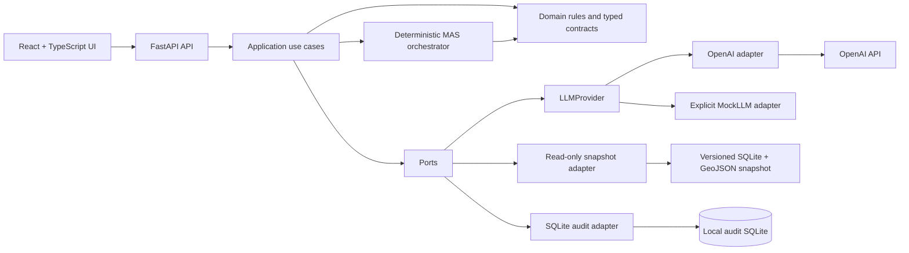
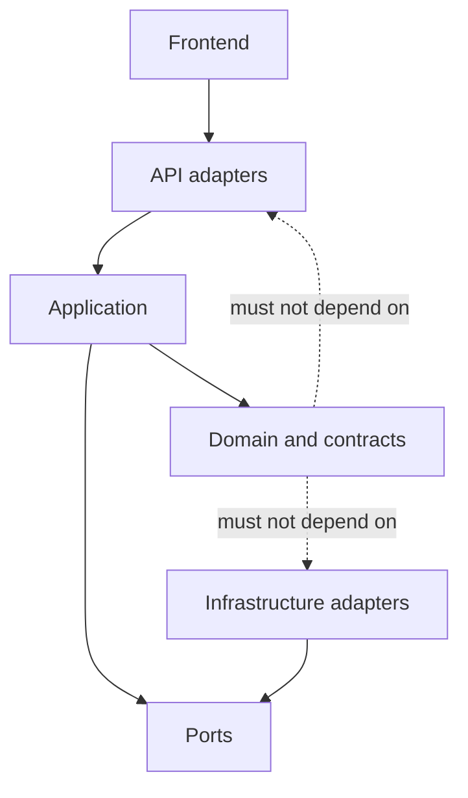
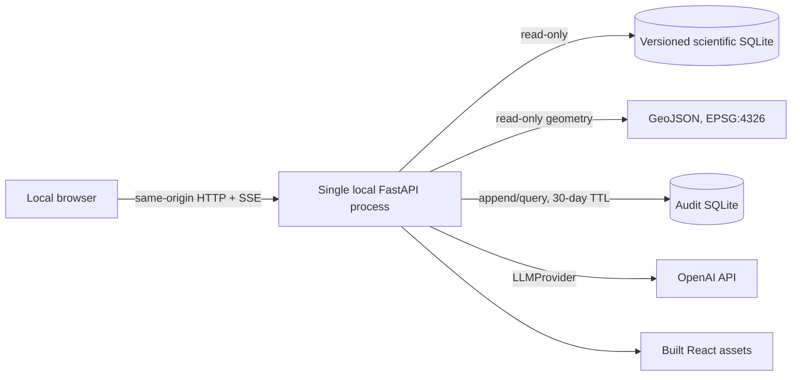
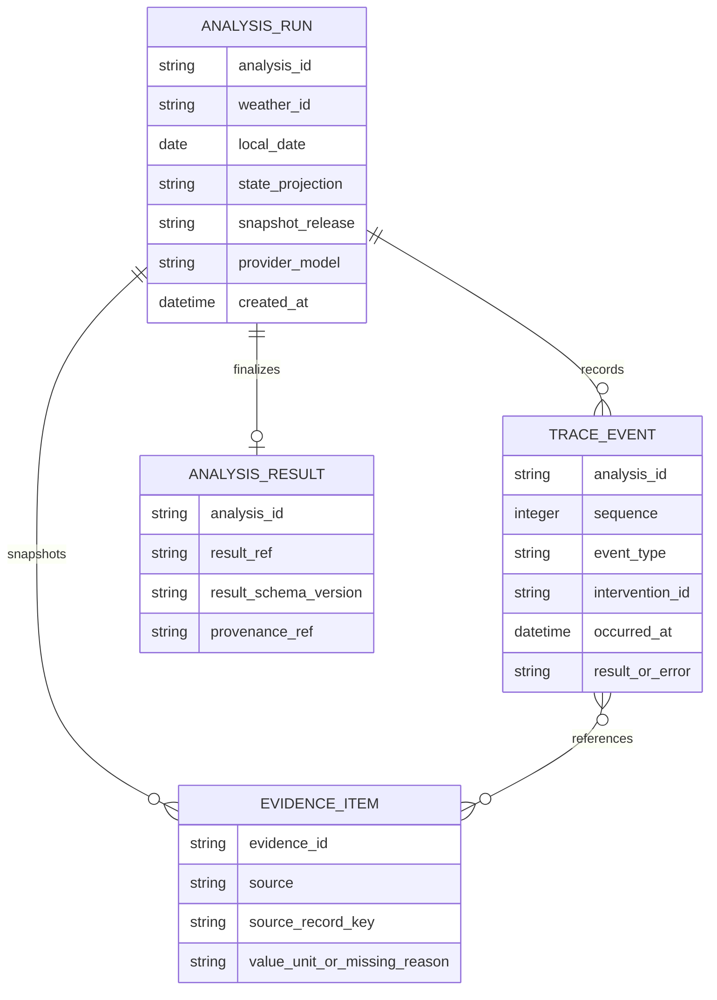

# Architecture Spine — FireWatch

## Design Paradigm

**Modular monolith using ports-and-adapters.** The FastAPI process hosts the HTTP API, application use cases, deterministic orchestration, agent workflow, read-only scientific-data access, and audit persistence. Domain rules do not depend on web, database, LLM-provider, or GIS framework details.



## Invariants & Rules

### AD-1 — Modular monolith and inward dependencies [ADOPTED]

- **Binds:** All application modules.
- **Prevents:** Framework, storage, or provider details leaking into scientific/business rules.
- **Rule:** Keep API, application, domain, MAS, and infrastructure boundaries explicit. Domain/application contracts are provider-neutral. No microservices or independently deployed workers in the MVP. Verify dependency direction with automated architecture/import checks; frontend modules may depend on generated/shared HTTP contracts only, never backend internals.

### AD-2 — Immutable, offline scientific snapshot [ADOPTED]

- **Binds:** Data access, startup, reproducibility, deployment, and user-visible provenance.
- **Prevents:** Silent source drift, runtime dependence on weather/FIRMS availability, and queries against unverified data.
- **Rule:** Runtime loads one local bundle containing (1) a read-only scientific SQLite database, (2) GeoJSON coverage/provincial-boundary files, and (3) a JSON manifest with `bundle_version`, `schema_version`, `release_id`, provenance/source references, date and spatial coverage, and each payload file's relative path, media type, byte size and SHA-256. Validate the manifest schema and supported versions, compare its release/version and the SHA-256 digest of the manifest bytes to expected values configured for the app, then verify every listed file's presence, size, digest, database schema, coverage IDs and geometries before readiness. Missing bundle/files, incompatible versions, or any validation/checksum failure makes readiness fail closed; never substitute another bundle, switch to writable mode, or retrieve scientific source data at runtime. Keep dataset scope and PRD-required quality-check outcomes/counts available as result provenance.

### AD-3 — One analysis per canonical location and local date [ADOPTED]

- **Binds:** Analysis API, result identity, workflow state, and UX navigation.
- **Prevents:** Ambiguous spatial interpolation, range aggregation, or a trace shared by multiple daily results.
- **Rule:** Each `AnalysisRun` is for one `weather_id` and one local calendar date. A selected date range only bounds daily navigation; each executed day gets its own run, MAS, state, result, evidence, and trace. Do not batch a range or aggregate FWI across dates.

### AD-4 — Deterministic science is authoritative [ADOPTED]

- **Binds:** FWI, meteorological values, historical comparison, FIRMS association, explanations, and all agent outputs.
- **Prevents:** An LLM changing, calculating, or presenting unsupported scientific values.
- **Rule:** The runtime loads versioned, precomputed scientific results and evidence. Deterministic services own validation and comparison arithmetic. LLM roles receive read-only, explicit evidence; they cannot query SQL, files, the Internet, external source APIs, or write datasets. The user-facing result keeps observations, deterministic calculations, and interpretation distinct.

### AD-5 — Deterministic orchestration of three bounded MAS roles [ADOPTED]

- **Binds:** Agent responsibilities, order, retries, errors, and output contracts.
- **Prevents:** Framework-owned hidden flow or agents presenting ungrounded results as scientific computation.
- **Rule:** A Python state machine coordinates the contextualizer, validator, and explainer. Shared JSON Schemas are authoritative in versioned `contracts/schemas/` files: `evidence-bundle.v1.json`, `contextualizer-input.v1.json`, `contextualizer-output.v1.json`, `validator-input.v1.json`, `validator-output.v1.json`, `explainer-input.v1.json`, and `explainer-output.v1.json`. Evidence IDs are unique within one `analysis_id` and references resolve only within that run; missing values use `value: null` plus a required machine-readable `availability`/`missing_reason`, never zero. Claims use `evidence_refs: string[]`; validator output is exactly `approved` or `revision_requested` with issue codes and affected claim/evidence IDs. Producers and consumers validate the same schemas. Additive optional fields may be added only in a new minor schema revision; changing required fields, enums, identity scope, or meaning requires a new major schema version. The validator may request at most one contextualizer revision; a retry is a new intervention. If a second validation does not approve the revised contextualization, stop the explanatory branch and finish `partial` with the deterministic FWI result and review issue evidence where available; never present an unapproved explanation as accepted. Deterministic post-checks validate schemas, evidence references, and numeric/source consistency.

### AD-6 — Provider-neutral LLM boundary [ADOPTED]

- **Binds:** LLM calls, provider configuration, prompts, and tests.
- **Prevents:** MAS logic depending on an SDK or one provider, or production silently masking provider failures with mock output.
- **Rule:** Roles use a common `LLMProvider` port and initially share one configurable OpenAI model through an isolated adapter. Read `OPENAI_API_KEY`, `FIREWATCH_LLM_PROVIDER`, `FIREWATCH_OPENAI_MODEL`, `FIREWATCH_LLM_TIMEOUT_SECONDS`, `FIREWATCH_LLM_MAX_RETRIES`, and `FIREWATCH_LLM_MAX_OUTPUT_TOKENS_PER_RUN` from environment configuration; timeout must be finite/positive, retries a finite integer from 0 through 2, and the per-run output-token ceiling a positive finite integer. Missing/invalid live configuration fails closed; do not silently select a different provider/model. Require provider structured-output/JSON-Schema support and validate every role output against the shared schema. Map authentication/permission, quota/rate-limit, timeout/network, refusal, and invalid/unsupported output to explicit typed provider errors and persist the failed intervention; no fallback to `MockLLM`. `MockLLM` is an explicit development/test provider selection only. Record configured provider/model, prompt/schema versions, and available request/usage metadata per run; never persist API keys. Do not impose a product latency target; operational timeout values remain configurable and are tuned from measured runs.

### AD-7 — Append-only execution trace is the source of MAS visibility [ADOPTED]

- **Binds:** Trace storage, dashboard updates, audit, and SSE replay.
- **Prevents:** Invented UI steps, mutable historical traces, and event loss after reconnect.
- **Rule:** Persist immutable, sequenced run/intervention events in the audit store, conforming to the authoritative `trace-event.v1.json` schema in `contracts/schemas/`. Required event types are `run_queued`, `run_started`, `analysis_core_result_persisted`, `tool_failed`, `intervention_started`, `intervention_completed`, `intervention_failed`, `review_approved`, `review_revision_requested`, `run_interrupted`, `run_completed`, `run_partial`, and `run_failed`. Every event has `schema_version`, `analysis_id`, monotonic `sequence`, `event_type`, UTC `occurred_at`, and an idempotency key unique within the run; intervention events also require unique run-scoped `intervention_id`, `agent_role`, `task`, and input evidence refs; completed events require a result summary or output reference and evidence refs; failed events require an error code and affected outputs; `tool_failed` requires the actual tool identifier/name, task, error code and affected outputs and is a system/tool event, never a fabricated agent intervention; review decisions require validator `intervention_id`, `decision`, and issue/claim refs; `analysis_core_result_persisted` requires the deterministic FWI result/evidence reference; run terminal events require affected outputs/result reference as applicable. `run_interrupted` is a system event, never an agent intervention. Evidence/result refs use IDs scoped to one run. Unknown event types/versions are rejected as invalid for writes and surfaced as unsupported for readers; additive optional fields require a minor version, incompatible changes a major version. Commit immutable events before SSE emission; SSE `id` equals sequence, replay is exclusive (`sequence > Last-Event-ID`), ordered, and consumers deduplicate by `(analysis_id, sequence)`. Durable SQLite rows are authoritative for delivery: after accepting a connection, query and emit ordered rows after the cursor; broadcaster notifications only wake the query loop, and periodic durable rechecks recover lost notifications. Thus replay/live handoff cannot omit a committed event. If a cursor predates retained events, return an explicit reset-required/incomplete response with the earliest available sequence; reject future cursors explicitly, and return an explicit not-found/expired response when retention has purged the run. Do not store prompts or hidden reasoning.

### AD-8 — Explicit run and intervention state machines [ADOPTED]

- **Binds:** API responses, trace projection, errors, partial results, and UX states.
- **Prevents:** Success-shaped fallbacks and conflating an incomplete run with an error-free completion.
- **Rule:** Append-only run events are authoritative for run state and trace completeness; the `analysis_runs` row is a transactionally maintained projection, not an independent source of truth. Each transition event and corresponding state-projection update commit in one SQLite transaction. A terminal event and the result/provenance it makes visible commit atomically; on any failure, roll back all writes in that transition and expose neither the terminal state nor its result. Enforce one event per transition with an idempotency key and uniqueness constraint so retries cannot create contradictory terminals. API result/state and trace-completeness projections must be derived from the same committed authority. A deterministic core FWI result and its evidence are committed with `analysis_core_result_persisted` before any LLM invocation. Run transitions are `queued → running → completed | partial | failed`; on backend startup, any retained `queued`/`running` run without a terminal event is closed atomically with a system `run_interrupted` event followed by terminal `run_partial` if a usable deterministic FWI result was committed, otherwise `run_failed`. Never automatically repeat an interrupted LLM call or invent agent events. An intervention is `running` after its start event and becomes `completed` or `failed` only after its corresponding terminal event. Reviewer decisions are separate events. `partial` preserves usable deterministic output when a dependent context/agent result is unavailable; `failed` means no usable central FWI result. Missing FIRMS detections are not a failure. Report the affected task/section explicitly.

### AD-9 — Typed HTTP contracts and one-way live events [ADOPTED]

- **Binds:** Frontend/backend integration and trace delivery.
- **Prevents:** UI assumptions drifting from server state and unnecessary bidirectional realtime infrastructure.
- **Rule:** FastAPI/Pydantic contracts are authoritative and exposed through OpenAPI. Use HTTP to start and query runs, and SSE for sequenced progress/trace events. Serve the built frontend from FastAPI on the same origin in the local MVP. Use one stable event sequence per analysis and support replay from `Last-Event-ID`.

### AD-10 — Data coverage and spatial identity are explicit [ADOPTED]

- **Binds:** Coverage API, selection constraints, GIS handling, and scientific values.
- **Prevents:** Arbitrary coordinates, silent nearest-cell substitution, fabricated interpolation, or loss of units/missingness.
- **Rule:** `weather_id` is the canonical spatial key for the existing 169-location, 0.25° EPSG:4326 grid. `GET /api/coverage` returns GeoJSON features whose `properties.weather_id` is the exact canonical ID accepted by `POST /api/analyses`; it also returns feature geometry, center coordinates, `center_inside` and `intersects` coverage flags, plus supported date bounds. The frontend selects/identifies one feature and submits that feature's `weather_id`; the backend validates membership and date availability and never resolves free coordinates, interpolates, or substitutes a nearest location. UX owns which features/control are selectable and how the flags are presented. Available analysis dates are 2021–2025; 2020 is spin-up from initial FFMC=85, DMC=6, DC=15; this is not validated local ecological calibration. FWI uses the 12:00 local observation and preceding 24-hour precipitation. Python `cffdrs` was cross-checked against R `cffdrs` for 31 days of January 2023 with observed max difference 0 for all six components in that period only; do not generalize this validation. Preserve the existing local `drought_code` correction for precipitation ≤2.8 mm. Preserve °C, %, km/h, mm, and unitless FWI indices. Missing values are null with an explicit state/reason, never zero.

### AD-11 — Local-only MVP and bounded audit retention [ADOPTED]

- **Binds:** Deployment, local storage, retention, and basic security.
- **Prevents:** Accidental public exposure, unnecessary cloud infrastructure, and indefinite user-history assumptions.
- **Rule:** Run frontend, API, orchestration, snapshot access, and audit SQLite on the defense machine, bound to loopback. OpenAI API is the only external runtime service. Keep no accounts or navigable user history. Retain each run, result, evidence, and trace locally for 30 days by default, purge automatically, and make the period configurable (`FIREWATCH_RUN_RETENTION_DAYS`); retained events remain immutable.

### AD-12 — Public evidence, source cautions, and limitations stay attached [ADOPTED]

- **Binds:** Evidence, narrative, sources, and interface contracts.
- **Prevents:** Treating FWI as probability, FIRMS as confirmed incidents, or same-day association as causal/predictive.
- **Rule:** Preserve source provenance and limitations with every result. FIRMS `type=0` is *presumed vegetation fire*; a thermal detection alone does not confirm an individual fire, and absence of associated detections does not establish absence of fire. Preserve the existing nearest-ERA5-center Haversine association and expose its recorded distance; report observed mean/max distances as 10.234 km / 20.944 km. Same-day association with 12:00 FWI is historical/descriptive, not causal: explicitly warn that a pre-noon detection may be paired with FWI based on later same-day weather. Do not add local risk categories or predictive metrics.

### AD-13 — Dependency direction [ADOPTED]

- **Binds:** All application modules.
- **Prevents:** Cyclic dependencies and infrastructure policy becoming domain policy.
- **Rule:** Inner modules define contracts; outer adapters implement them. The frontend depends only on generated/shared HTTP contracts, never backend internals. Automated architecture/import checks enforce backend dependency direction; frontend checks prevent imports from backend modules.



### AD-14 — Accessible, honest live-trace projection [ADOPTED]

- **Binds:** Frontend event announcements and trace API/read models.
- **Prevents:** Screen-reader interruption on every event, or an unavailable/incomplete trace being misreported as proof that no agent participated.
- **Rule:** Expose trace availability/completeness separately from its event list, distinguishing not-yet-recorded, available, incomplete (including a terminal run with no expected trace events), and unavailable/error states. Announce run start/terminal state changes and intervention start/terminal state changes, but coalesce or omit repetitive low-level progress so announcements do not interrupt repeatedly; validator decisions remain inspectable in the trace whether or not individually announced. Verify with keyboard/screen-reader tests that updates are announced and trace completeness is exposed in text. Never infer missing participation from absent/unavailable events.

### AD-15 — Retain the scientific pipeline behind a validated snapshot seam [ADOPTED]

- **Binds:** Brownfield data processing and runtime data access.
- **Prevents:** Duplicating/reimplementing scientific transformations in the web request path or changing pipeline meaning while adding the application.
- **Rule:** Retain the existing `src/data` generators and validators as the offline scientific pipeline; their current gzipped CSV outputs (`fwi_larioja_<year>.csv.gz`, `firms_fwi_larioja_2021_2025.csv.gz`, and `analytical_larioja_2021_2025.csv.gz`, with `weather_locations_unique.csv` coverage metadata) remain the source output contract. The runtime must not import scripts as request handlers or regenerate source datasets. A separate release builder validates these outputs and packages a versioned SQLite + GeoJSON snapshot with manifest/checksums; the read-only snapshot adapter consumes that published contract. Any pipeline/schema transformation change requires a new snapshot release and validation; existing scientific scripts are wrapped at the release boundary rather than rewritten for the MVP.

### AD-16 — Reproducible local operations and release gates [PROPOSED]

- **Binds:** MVP installation, launch/shutdown, SQLite lifecycle, logs, external-provider access, and demonstration readiness.
- **Prevents:** Unbounded or untested real-provider calls and implicit operational behavior becoming an implementation choice.
- **Rule:** The local app runs one FastAPI worker/process; reject multi-worker mode for the MVP because event ordering, local queue, and SQLite audit writes have one owner. Before enabling real OpenAI calls, configure and test a finite request timeout, bounded retries, and per-run usage/cost ceiling; without those values the adapter fails closed. Before demonstration, verify API account data controls, provisioned snapshot identity/checksums, clean startup/readiness, graceful shutdown, and OpenAI connectivity. SQLite schema changes use ordered, versioned migrations before accepting requests; define and test busy/locking behavior before implementation. Local structured logs are rotated/purged under a documented finite policy before demo; do not log prompts, secrets, or hidden reasoning. Keep exact launch command, shutdown handling, migration locking and log-retention values in deployment documentation once tested.

## Consistency Conventions

| Concern | Convention |
| --- | --- |
| Identifiers and events | `analysis_id` identifies a run; each actual agent invocation has a distinct `intervention_id`; trace sequence starts at 1 and is monotonic within a run. Event type is explicit and immutable. `trace-event.v1` is shared by persistence/API/SSE/read models; delivery ID equals sequence, replay is exclusive and ordered, consumers tolerate duplicates by `(analysis_id, sequence)`. |
| Dates and units | API date is an ISO local calendar date in `America/Argentina/La_Rioja`. Values preserve source units; FWI components are unitless indices. |
| Missing data | Represent as null plus a machine-readable availability/missing reason. Never coerce missing data to zero. |
| Evidence | Versioned bundle and schema. Claims and trace outputs reference evidence IDs resolved within that analysis; persist source, release, source-record key, observation time, value/unit or missing reason. |
| Dataset quality | Keep dataset scope, record counts, and checked quality outcomes in provenance available from the result; do not imply that startup checks alone satisfy the user-facing research-data disclosure. |
| Versioned contracts | `contracts/schemas/` is the authority for event, evidence-bundle, and role input/output schemas. Producers, persistence and API consumers validate against the same version. |
| Errors | Return explicit machine-readable code/message/details and correlation/run ID where available. Do not silently default or convert errors to success. Trace responses expose `not_yet_recorded`, `available`, `incomplete`, or `unavailable` separately from the event list; unknown/expired analysis or cursor is explicit, never a successful empty trace. |
| Configuration | Environment-based configuration. `FIREWATCH_SNAPSHOT_VERSION` and `FIREWATCH_SNAPSHOT_MANIFEST_SHA256` pin the expected local bundle; LLM variables are `OPENAI_API_KEY`, `FIREWATCH_LLM_PROVIDER`, `FIREWATCH_OPENAI_MODEL`, `FIREWATCH_LLM_TIMEOUT_SECONDS`, `FIREWATCH_LLM_MAX_RETRIES`, and `FIREWATCH_LLM_MAX_OUTPUT_TOKENS_PER_RUN`. API key is never stored in Git. Local `.env` files, if used, remain untracked. |
| Prompt/model audit | Store provider/model and prompt/schema version metadata; do not persist raw prompts or hidden reasoning. |
| Accessibility | Implement and test the approved WCAG 2.2 AA floor, keyboard behavior, focus, non-color state communication, table reading, and responsive trace/table layouts. |

## Stack

Baseline versions verified against package registries and official release metadata on 2026-10-07. Lock exact dependencies when implementation begins.

| Name | Version / status |
| --- | --- |
| Python | `>=3.13` (inherited manifest/lock setting; confirm deliberate support floor and target-platform compatibility before implementation) |
| FastAPI | `0.142.4` candidate baseline; not yet installed |
| Pydantic | Transitive FastAPI contract dependency; exact resolution is pinned by the implementation lockfile and OpenAPI regression checks |
| Uvicorn | `0.54.0` candidate baseline; not yet installed |
| OpenAI Python SDK (adapter only) | `3.26.0` candidate baseline; real-provider calls remain gated |
| React / React DOM | `19.3.0` candidate baseline; not yet installed |
| TypeScript | `7.0.2` candidate baseline; not yet installed |
| Vite | `8.3.3` candidate baseline; not yet installed |
| Node.js | `24.21.0` LTS candidate baseline |
| Data stack | Existing `uv` lock: pandas 3.0.6, GeoPandas 1.1.4, cffdrs 0.3.0 (Git revision locked in uv.lock) |
| Persistence | Python SQLite (scientific DB read-only; separate writable audit DB) |
| Spatial exchange | GeoJSON, EPSG:4326 |

Exact versions and Python/React lockfiles are checked and pinned when those projects are created. These candidate version baselines do not block architectural ratification; test installation/build compatibility then.

## Structural Seed

### Runtime and deployment



The scientific snapshot is supplied as a separate, immutable release artifact rather than committed with generated data. The manifest/checksums and expected release reference are version-controlled. Runtime startup verifies snapshot identity and integrity before readiness. Automatic snapshot replacement/update is not part of an analysis run.

Minimum bundle layout:

```text
snapshot/
  manifest.json
  data/scientific.sqlite
  coverage/province.geojson
  coverage/weather-grid.geojson
```

The manifest declares bundle/schema version, release ID, provenance and source references, spatial/date coverage, and each payload's relative path, media type, size and SHA-256. The application configuration pins the expected bundle version and SHA-256 digest of the canonical manifest; manifest entries then verify each payload. Startup opens SQLite read-only and validates its schema, the 169 canonical `weather_id`s, matching coverage features, supported dates, file sizes and checksums. Any absent file, incompatible version/digest, invalid coverage or integrity failure prevents readiness. Packaging/distribution remains a local provisioned bundle for MVP, not a remote service.

### Core records



The ordered `TRACE_EVENT` log is authoritative for run state and trace completeness. `ANALYSIS_RUN.state_projection` is updated with its event in the same SQLite transaction. The terminal event and `ANALYSIS_RESULT`/provenance become visible together or not at all.

### Proposed repository layout

```text
src/
  data/                              # Existing offline source/data pipeline
  sistema_incendios_forestales/
    api/                             # FastAPI routes, request/response models
    application/                     # Use cases, deterministic orchestration
    domain/                          # Analysis, evidence, state and policy types
    agents/                          # Role prompts and versioned schemas
    infrastructure/
      llm/                           # LLMProvider, OpenAI and MockLLM adapters
      persistence/                   # Read-only data and audit SQLite adapters
      geo/                           # Coverage and GeoJSON adapters
frontend/
  src/                               # React/TypeScript single analysis surface
data/
  raw/                               # Existing source inputs; not runtime-loaded
  processed/                         # Existing generated data; ignored by Git
  snapshots/<release-id>/            # Provisioned, immutable runtime snapshot
```

### API surface

| Contract | Purpose |
| --- | --- |
| `GET /api/coverage` | Return all 169 canonical `weather_id`s as GeoJSON features with exact `properties.weather_id`, geometry, center coordinates, `center_inside`/`intersects` flags, available dates and snapshot provenance. |
| `POST /api/analyses` | Start one run for `{weather_id, date}`; return `202` and a new `analysis_id`. Reject unknown `weather_id` or unavailable dates explicitly. |
| `GET /api/analyses/:analysis_id` | Return current run state and available result/provenance. |
| `GET /api/analyses/:analysis_id/trace` | Return event-derived intervention/decision projection, evidence references and explicit `not_yet_recorded` / `available` / `incomplete` / `unavailable` status. A terminal run with no expected events is incomplete; missing/unavailable data does not imply no agents participated. |
| `GET /api/analyses/:analysis_id/evidence/:evidence_id` | Resolve the actual persisted evidence referenced by result or trace. |
| `GET /api/analyses/:analysis_id/events` | SSE stream with `id=sequence`; exclusive ordered replay after `Last-Event-ID`, duplicate tolerance and gap-free durable catch-up. Expired/missing runs, future cursors and sequence gaps return explicit reset/error/incomplete semantics. Browser reload/restart has no global history or automatic analysis restoration; the backend run continues independently of browser connectivity, and a client that still holds `analysis_id` can fetch state and replay. |
| `GET /api/health/ready` | Expose local readiness, including scientific snapshot integrity. |

## Capability → Architecture Map

| Capability / Area | Lives in | Governed by |
| --- | --- | --- |
| Coverage, sources, data restrictions (PRD §4.1) | Offline pipeline, snapshot manifest, coverage API | AD-2, AD-10, AD-12 |
| Dataset scope and quality (PRD FR-3) | Snapshot metadata and result provenance | AD-2, Dataset quality convention |
| Exploratory descriptive results (PRD FR-8) | Versioned precomputed study statistics, denominator/interpretation provenance, result API projection | AD-2, AD-4, AD-12 |
| FWI and environmental values | Existing Python data pipeline and read-only snapshot adapter | AD-2, AD-3, AD-4, AD-10 |
| Historical local-monthly reference | Deterministic application/domain service over snapshot values | AD-3, AD-4, AD-10 |
| FIRMS historical evidence | Snapshot adapter and evidence contracts | AD-2, AD-4, AD-12 |
| MAS context, review, explanation | Python state machine and three role contracts | AD-4, AD-5, AD-6, AD-8 |
| User-visible trace | Audit SQLite, trace projection, SSE/API | AD-7, AD-8, AD-9 |
| Accessible trace availability and live announcements | Trace read model and React surface | AD-14, Accessibility convention |
| Existing scientific pipeline and snapshot migration seam | Retained `src/data` generators/validators, release builder, read-only adapter | AD-2, AD-15 |
| Single analysis surface | React/TypeScript app served by FastAPI | AD-9, Accessibility convention |
| Local reproducible demonstration | Local launch, verified snapshot, environment config | AD-2, AD-6, AD-11 |

## Deferred

- **Spatial-selection interaction:** UX decides the visible selector and which coverage flags/features are selectable; the API contract is fixed to GeoJSON feature → canonical `weather_id`.
- **Snapshot artifact release/provisioning:** generate the release ID, bundle files and matching expected version/manifest digest, then provision that local bundle to the demo machine. No remote distribution service or automatic runtime replacement is part of the MVP.
- **OpenAI deployment values:** choose model, finite timeout, retry count within 0–2, and per-run output-token ceiling through local environment configuration and operational tests; no latency target is asserted as a product requirement. Real calls remain gated on valid credentials and review of account data controls.
- **Exact dependency versions and lockfiles:** check compatibility and lock Python/React dependencies when creating those projects; this does not block ratifying the technology contracts.
- **Local queue capacity and migration/log policy values:** keep one process and durable state rules; choose/test exact queue cap, SQLite busy/locking settings and finite log rotation values while implementing local operations.
- **Remote hosting/security:** outside MVP; before any network-accessible deployment decide authentication/authorization, TLS, rate limits, secret management and allowed origins.
